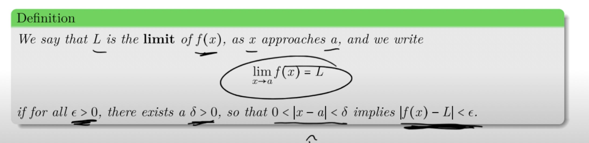
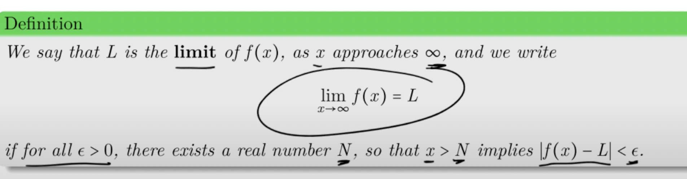
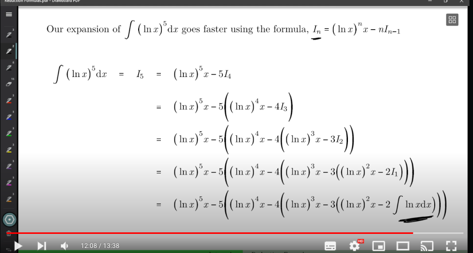
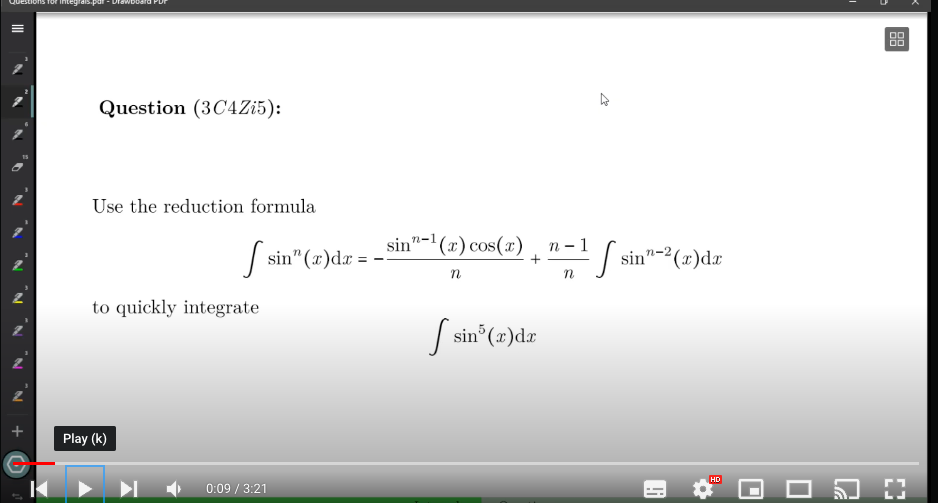
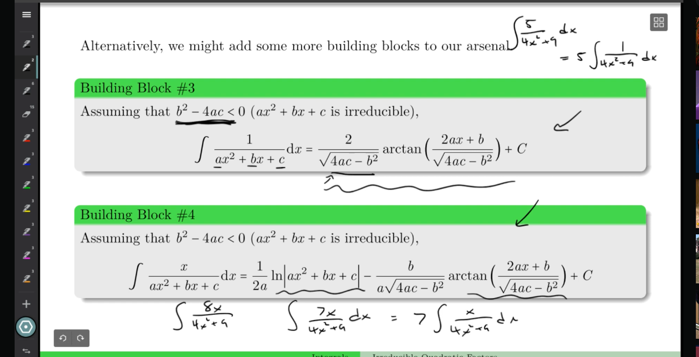
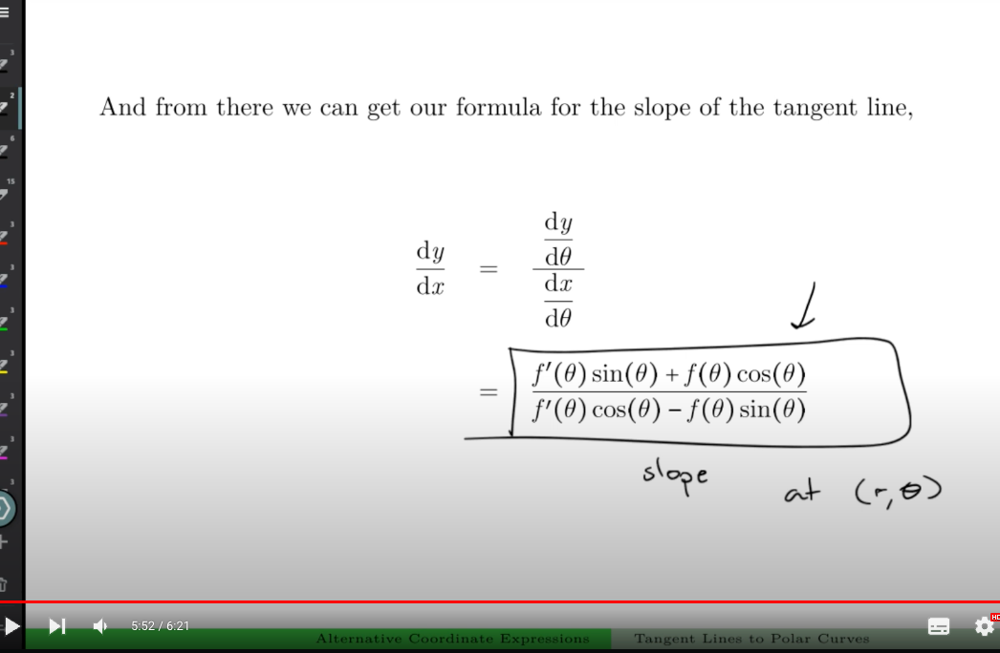

- Week 1: Limits, Rolle's Theorem, MVT
	- What confuses me about the proper definition of the limit is why delta is needed when we can just say 'atleast one x'. i suspect it's to keep it 'both sides'' to captuer the bound/range
	- 
	- 
	- Rolle's Theorem Proof
	  collapsed:: true
		- We can prove Rolle's theorem from the EVT and Fermat's theorem. EVT says that for a function which is continuous on a closed interval [a,b], f(x) HAS TO reach a max and min value over this interval. There exists a y value that is a max which is always greater or equal to any f(x) value and a y value that is a min which is less than or equal to any f(x) value. Fermat's theorem says that for any function defined on the open interval (a,b) that has a local max or min, the deriv at that local max or min will be 0 or undefined
		- Fermat's theorem says defined, which allows for the possibility of jump discontinuities while EVT doesn't.
		- Therefore, if we create a function that's differentiable over (a,b) and continuous over [a,b], it will HAVE to reach a local max/min BUT we run into a problem. What if the end points are the local min/max? If they are, then the derivative at that point will be undefined. We therefore have to make sure the min/max is not at the end of the function. We know we won't have an asymptote at the bounds of the interval too
		- The genius is that by equating f(a) and f(b), if they're the min and the max and they're constant, then the function has to be a constant
		-
	- MVT Proof
	  collapsed:: true
		- MVT says that for a function which is differentiable over the open interval (a,b) and continuous on the closed interval [a,b], there exists a value c in [a,b] s.t the derivative at this c is equal to (f(b)-f(a)/(b-a)). In other words, there's a point in the interval who's slope is equal to the slope derivative of the function over the interval
		- Imagine f(x) is x^2 and [a,b] is [0,2].
		- Use Rolle's theorem to prove MVT. We could imagine a new functtion l(x) which is just a straight line from a to b; l(x) = mx+b= (f(b)-f(a)/(b-a)) = (4-0/2))x + b = 2x + b. when x =2, y=4 and b =0. so l(x) is y=2x.
		- Now we take the difference between f(x)-l(x) to create a new function. The beauty of this new function is that because it's the difference between two functions, the new function, g(x)= 2x-x^2, is 0 at both end points of the interval. Rolle's theorem applies to it and says there exists a local min/max in g(x) w a derivative of 0
		- How can I relate this to my OG function, y=x^2? It seems that the space where the difference between the two functions is largest and g(x) peaks is the c value where MVT is true.
		- prove there always exists a f'(c) = (f(b)-f(a)/(b-a)) where c is in [a,b]
		- g(c) = f(c) - f'(c).
		- g'(c) = f'(c) - f''(c). and we know that there exists a value D s.t g'(c) = 0 bc g(x) fulfills Rolle's. So we plugin that D > g'(d) = 0 = f'(d) - f''(d) > f'(d) = f''(d).
		- 0 = f'(d) - f''(d) > f''(d) = f'(d) > l'(d) = f'(d). We know l(x)'s slope was (f(b)-f(a)/(b-a)) and as a constant the slope is fixed. This means that f'(d) = (f(b)-f(a)/(b-a))  and hence MVT is proved
		-
	- MVT applied to prove that f(x) is constant if f'(x) = 0
		- MVT says that there exist a C in [a,b] s.t  f'(C)=(f(b)-f(a))/(b-a)
- Reduction formula for powers of logn
  collapsed:: true
	- 
- Reduction formula for sinx
  collapsed:: true
	- 
- Irreducible Quadratic Integration via Arctan
	- 
- Convert polar point to cartesian
	- x=rcostheta, y=rsintheta
- Convert Cartesian to polar point
  collapsed:: true
	- r squared=x squared + y squared
	- tan theta = y/x
- Tangent line to polar curve
	- formulas for dy/dtheta and dx/dtheta are from a) r = f(theta) b) plugin f(theta) for both equations and derive. Vertical tangent is when dx/dtheta is 0 but dy/dtheta isn't, horizontal tangent is when dy/dtheta= 0 but dx/dtheta isn't
	- 