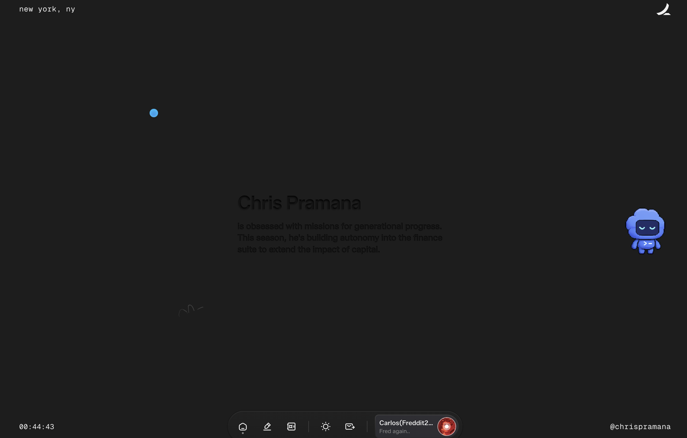

- What’s the primary emoitno of our time? LIke if i were to tell teh story of a family? what would it be like? i feel the reason why sometihng ilke yiyi resonates is because it was right at the begining of ‘modernization’ for taiwan, and yang was hence able to caputre something new by etlling the story of a famil yas indivudals alone that reunite every onec inc awhile. friends (idk what friends is like, i should watch friedns to be honest and see lol). but for our life, modern life is sometihng more about. like what’s the reccurring pattern here? friends means you keep on hangin gout withfriends, but modern life is just us being alone. that’s it. all your friends have moved away after HS/university, your squad is split all over the world. you see each other like 2-3x a year or somethnig. the modern equivalent is more like the office? like an idealised, jokey work place, your family. ok don’t overintellectualize it, i should jsut start working on a set of caharcetrs and scripts. and figrue out ohw i would knock off the ideas overitme and figuero out which to invest in
- friends = i wsih i had people like this. office = i know people are like this. the first has people who are more “whole” nad balanced, the 2nd has caharcters taht should feel more like cliches/stereotypes, where the venn diagram of their attributes don’t overlap as much bc they’re so extreme
-
- Idea 1: I want to make the aduince feel like this is all a fuknig joke. like somehow you’re expceted to grindslop. chainsmoker cat-ish in terms of accepting burnout, celine like but instead of nationalism it’s the expectation that we’re supposde to work so hard. like i feel like what leon si/amazon guy i interviewed/what i’m feeling is the early vanguard of what’s to come for more ppl. not everyone is a “gifted kid”, but we all feel.
	- Character 1 is
	- 
